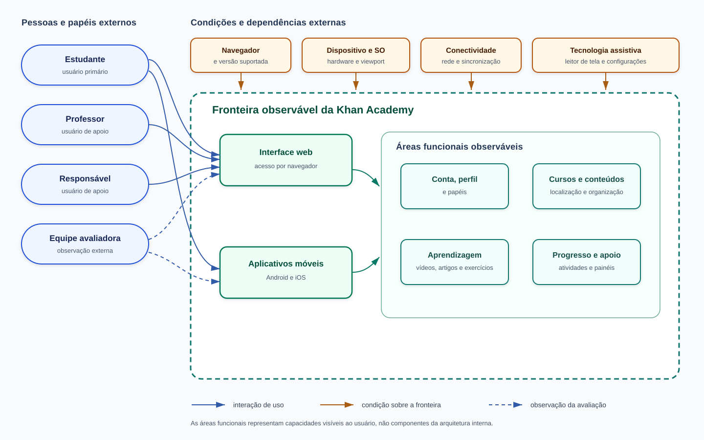

# Produto e contexto de uso da Khan Academy

Este documento caracteriza o produto e o contexto de uso da Khan Academy, delimitando
suas áreas funcionais observáveis, interfaces externas, dependências de ambiente e os
perfis de usuários considerados na avaliação. A caracterização foi elaborada a partir
de documentação pública oficial da plataforma, consultada em **18 de outubro de 2026**.

As três marcações abaixo diferenciam a natureza das informações:

- **Documentado:** informação sustentada por fonte oficial;
- **Proposto:** hipótese analítica da equipe a ser validada no planejamento da
  avaliação;
- **Não observável:** elemento para o qual não há evidência pública ou acesso técnico
  suficiente.

O [propósito e as características de qualidade](requisitos-de-avaliacao.md) são mantidos no documento específico de requisitos. Os objetos, ambientes, tarefas, participantes e exclusões selecionados para os ensaios estão definidos no [Escopo da avaliação](escopo-da-avaliacao.md). Esta caracterização apresenta o ecossistema mais amplo do produto e fornece rastreabilidade para essas decisões, sem ampliar o escopo estabelecido.

## 1. Classificação e finalidade do produto

A Khan Academy é classificada, para esta avaliação, como um **produto de software
educacional interativo, disponibilizado como serviço on-line por interface web e por
aplicativos móveis oficiais**. A classificação descreve a forma observável de entrega e uso, sob a perspectiva de caixa preta; não implica conhecimento da arquitetura interna nem de relações contratuais do serviço.

Segundo a organização, sua missão é oferecer educação gratuita e de alta qualidade a
qualquer pessoa, em qualquer lugar. O produto disponibiliza cursos e recursos para
estudantes, professores e responsáveis, com conteúdos do ensino básico ao início do
ensino superior [S1](#s1). No contexto desta avaliação, **estudantes são os usuários
primários**. Professores e responsáveis são usuários de apoio porque podem organizar
atividades, acompanhar progresso e orientar o uso [S2](#s2), [S6](#s6), [S7](#s7) e [S11](#s11).

### 1.1 Fronteira adotada para caracterização

A fronteira documental abrange o site principal da Khan Academy e seus aplicativos
oficiais para Android e iOS, além das funções diretamente expostas por essas
interfaces. Os itens abaixo são ofertas ou formas de distribuição relacionadas, mas
não devem ser presumidos como parte do objeto de avaliação:

- **Khan Academy Kids**, produto voltado a crianças de dois a oito anos e divulgado
  separadamente [S1](#s1), [S3](#s3);
- **Khanmigo**, oferta de tutoria e apoio com inteligência artificial apresentada
  separadamente pela organização [S1](#s1);
- **Khan Academy Districts**, oferta institucional não necessária aos fluxos gerais
  de estudantes, professores e responsáveis [S1](#s1);
- distribuição por **Kolibri** para contextos sem conectividade, indicada como uma
  alternativa em parceria, e não como a interface web ou o aplicativo móvel principal
  [S3](#s3).

Essa fronteira documenta o ecossistema oficial do produto, contemplando tanto a interface web quanto os aplicativos móveis oficiais para Android e iOS. Os recortes e superfícies selecionados para os ensaios práticos são deliberados em [Escopo da avaliação](escopo-da-avaliacao.md).

## 2. Requisitante e partes interessadas

Para contextualizar os papéis, o propósito é produzir evidências que apoiem a
coordenação do cenário de escola pública a decidir se recomenda a Khan Academy Web
em computadores e sob quais condições, além de orientar decisões sobre
acessibilidade, introdução ao uso e desenho da medição. A formulação completa e as
decisões `D1` a `D4` permanecem no [documento de requisitos](requisitos-de-avaliacao.md#proposito), evitando duplicar sua definição normativa.

### 2.1 Distinção entre os papéis

O [Propósito da avaliação e uso pretendido](requisitos-de-avaliacao.md#proposito)
define o cenário de escola pública, o requisitante e as decisões [`D1`](requisitos-de-avaliacao.md#13-requisitante-e-destinatarios-dos-resultados) a [`D4`](requisitos-de-avaliacao.md#13-requisitante-e-destinatarios-dos-resultados) que os
resultados devem apoiar. Esta seção detalha as partes interessadas desse cenário sem
redefinir o propósito. No documento de requisitos, a coordenação da escola pública é
o **[requisitante da avaliação](requisitos-de-avaliacao.md#13-requisitante-e-destinatarios-dos-resultados)**. Para manter a consistência, esta caracterização adota
a mesma convenção e distingue dois planos:

1. **Demandante acadêmico:** a disciplina Qualidade de Software 1, representada pela
   docente, determina a realização do trabalho e seus critérios de entrega.
2. **Requisitante da avaliação:** a coordenação da escola pública que, no cenário
   hipotético adotado, decidiria se recomenda o produto como apoio ao ensino. Nenhuma
   escola real contratou ou solicitou o estudo.

A Khan Academy **não é o requisitante**: não houve contato formal nem solicitação da
organização. Ela é fornecedora/mantenedora do produto observado e possível destinatária
dos resultados. Os avaliadores são os integrantes da equipe; os estudantes,
professores e responsáveis são usuários ou representantes do contexto de uso.
Não foi identificado comprador, contratante ou operador institucional real. Criar esses
papéis apenas para completar uma classificação produziria uma relação inexistente; no
cenário hipotético, a coordenação exerce o papel de requisitante e tomadora da decisão
de adoção.

### 2.2 Matriz de stakeholders

Os critérios de sucesso na tabela 1 abaixo são **propostas da equipe**, derivadas da rubrica, do
cenário de aplicação e da documentação oficial. Não foram obtidos por entrevista e
precisam ser confirmados antes de orientar decisões definitivas de escopo.

| Categoria | Parte interessada | Papel e necessidade | Expectativa ou critério de sucesso proposto | Influência sobre a avaliação |
|---|---|---|---|---|
| Demandante acadêmico | Disciplina Qualidade de Software 1, representada pela docente | Determina a realização de uma avaliação de produto baseada na família SQuaRE e verifica a entrega acadêmica. | Processo rastreável   escolhas justificadas   evidências verificáveis   atendimento à rubrica e aos prazos. | Define critérios de qualidade do trabalho, entregas e restrições metodológicas. |
| Requisitante da avaliação (cenário hipotético) | Coordenação da escola pública definida no documento de requisitos | No cenário, precisa decidir se e em quais condições recomendar a Khan Academy Web aos estudantes. | Receber evidências delimitadas por ambiente, fluxo e perfil, com limitações explícitas, suficientes para fundamentar a recomendação. | Toma a decisão `D1` e orienta a seleção de computadores, navegadores e condições de rede, além da forma de apresentar os resultados   **Não** representa uma solicitação de escola real. |
| Avaliadores | Integrantes da equipe do projeto | Planejam, executam, registram e interpretam a avaliação externa dentro do prazo e dos recursos disponíveis. | Procedimento viável, reproduzível e coerente com as normas   Separação entre fatos, hipóteses e evidências coletadas. | Tomam a decisão `D4` e definem instrumentos e rigor   Limitações de ferramentas, participantes e equipamentos determinam os cortes e os limites de validade. |
| Usuários primários | Estudantes, inclusive iniciantes, pessoas com baixa visão e usuários de tecnologia assistiva | Precisam localizar conteúdos, estudar e realizar atividades nas condições de acesso disponíveis [S1](#s1), [S5](#s5), [S8](#s8), [S9](#s9). | Concluir os fluxos selecionados sem barreiras impeditivas e com desempenho aceitável segundo métricas que ainda serão operacionalizadas. | Suas necessidades fundamentam as decisões `D1` a `D3`, os fluxos `FL1` a `FL4` e a seleção de desempenho, adaptabilidade, acessibilidade e apreensibilidade. |
| Usuários de apoio | Professores | Organizam turmas, atribuem atividades e acompanham o progresso para apoiar estudantes [S2](#s2), [S6](#s6). | Receber informação suficiente para recomendar as condições de acesso e decidir se o estudante necessita de introdução ao uso   O painel docente permanece fora dos ensaios. | Participam das decisões `D1` e `D3`; influenciam as tarefas introdutórias e a interpretação de dificuldades de aprendizagem do uso. |
| Usuários de apoio | Pais e responsáveis | Vinculam contas de estudantes, especialmente crianças, acompanham atividade e progresso e orientam o uso [S6](#s6), [S7](#s7), [S11](#s11). | Receber informação sobre barreiras e ajustes de acessibilidade relevantes ao apoio do estudante   O painel de responsáveis permanece fora dos ensaios. | Participam da decisão `D2` e introduzem o cuidado com estudantes menores, sem tornar privacidade, segurança ou o painel de responsáveis objetos de teste. |
| Fornecedor/mantenedor e destinatário potencial | Khan Academy e suas equipes de produto | Mantêm as interfaces públicas e podem, em tese, utilizar achados externos para melhoria. | Receber achados reproduzíveis, associados a versões, ambientes e passos, sem alegação de certificação. | A documentação e as versões públicas delimitam o que pode ser observado. Não há influência direta ou aceite formal nesta avaliação. |

*Tabela 1. Matriz de partes interessadas e influência na avaliação. Fonte: Elaborado por: [Enzo Menali](https://github.com/menali17)*

### 2.3 Rastreabilidade com o propósito e o uso pretendido

A relação entre os stakeholders desta caracterização e as decisões definidas no
[documento de requisitos](requisitos-de-avaliacao.md#proposito) é direta:

- [`D1`](requisitos-de-avaliacao.md#13-requisitante-e-destinatarios-dos-resultados): coordenação, professores e estudantes fundamentam a decisão sobre recomendar
  a plataforma web nos computadores, navegadores e condições de rede avaliados;
- [`D2`](requisitos-de-avaliacao.md#13-requisitante-e-destinatarios-dos-resultados): estudantes com baixa visão ou que usam leitor de tela, professores e
  responsáveis fundamentam a decisão sobre indicação e ajustes de acessibilidade;
- [`D3`](requisitos-de-avaliacao.md#13-requisitante-e-destinatarios-dos-resultados): estudantes novos e professores fundamentam a decisão sobre a necessidade de
  uma introdução ao uso da plataforma;
- [`D4`](requisitos-de-avaliacao.md#13-requisitante-e-destinatarios-dos-resultados): a equipe avaliadora utiliza necessidades, prioridades e limitações dos demais
  stakeholders para definir objetivos, questões, métricas e rigor da avaliação.

A coordenação corresponde ao requisitante da [seção 1.3](requisitos-de-avaliacao.md#13-requisitante-e-destinatarios-dos-resultados) do documento de requisitos. A
Khan Academy permanece apenas como destinatária potencial dos achados, sem se tornar
tomadora das decisões [`D1`](requisitos-de-avaliacao.md#13-requisitante-e-destinatarios-dos-resultados) a [`D4`](requisitos-de-avaliacao.md#13-requisitante-e-destinatarios-dos-resultados).

Essa influência aparece materialmente no escopo: as necessidades dos estudantes
determinam os fluxos `FL1` a `FL4`; a decisão de recomendação da coordenação direciona
os ambientes de computador e as condições de rede; os perfis de acessibilidade
determinam as combinações com teclado e leitores de tela; e os recursos disponíveis
aos avaliadores limitam a quantidade de ambientes, repetições e participantes.

## 3. Descrição estruturada do software

### 3.1 Áreas funcionais observáveis

A Tabela 2 organiza funções públicas por área de uso. A palavra “área” evita inferir
módulos internos: são agrupamentos funcionais percebidos externamente.

| Área funcional observável | Funções documentadas relevantes | Usuários relacionados | Fonte |
|---|---|---|---|
| Conta, perfil e papéis | Criação e edição de conta; seleção de papéis de estudante, professor ou responsável; vinculação opcional a provedores de identidade. | Estudantes, professores e responsáveis | [S6](#s6), [S10](#s10) |
| Localização e organização de conteúdos | Seleção de cursos, visualização de conteúdos e organização da página inicial do estudante. | Estudantes | [S1](#s1), [S5](#s5) |
| Aprendizagem | Acesso a vídeos, artigos, exercícios interativos e prática com níveis de domínio. | Estudantes | [S1](#s1), [S3](#s3) |
| Atividades e metas | Exibição de tarefas atribuídas e metas de domínio na página inicial e nos aplicativos. | Estudantes e professores | [S2](#s2), [S3](#s3), [S5](#s5) | 
| Progresso e apoio | Acompanhamento de atividade e progresso pelo estudante; painéis para professores; vinculação e acompanhamento por responsáveis. | Estudantes, professores e responsáveis | [S2](#s2), [S5](#s5), [S7](#s7), [S11](#s11) |
| Continuidade entre interfaces | Sincronização do progresso entre aplicativo e site quando há conta; download de vídeos para estudo off-line no aplicativo. | Estudantes | [S3](#s3) |
| Preferências de acessibilidade | Opções para reduzir movimento, ocultar conteúdo que dependa de interação visual, remover cor de vídeos e exibir legendas, conforme disponibilidade documentada. | Estudantes com necessidades de acessibilidade | [S8](#s8) |

*Tabela 2. Áreas funcionais observáveis do produto. Fonte: Elaborado por: [Enzo Menali](https://github.com/menali17), com base nas fontes indicadas*

### 3.2 Interfaces externas

A Tabela 3 apresenta as principais interfaces externas do sistema e suas respectivas implicações para o escopo e ambiente da avaliação.

| Interface | Descrição verificável | Implicação inicial para a avaliação |
|---|---|---|
| Interface web | Acesso ao site pelas versões atuais de Chrome, Edge, Firefox e Safari; navegadores antigos podem não oferecer todas as funções [S4](#s4). | A adaptação a diferentes resoluções e tamanhos de tela permanece objeto da avaliação. Navegador, sistema operacional, viewport e versão precisam ser registrados. |
| Aplicativo Android | Aplicativo oficial distribuído pelo Google Play, com exercícios, atividades, sincronização e download de vídeos [S3](#s3). | Pode diferir da web e do iOS, mas permanece fora dos ensaios definidos no escopo. |
| Aplicativo iOS | Aplicativo oficial distribuído pela App Store, com funções móveis documentadas [S3](#s3). | Requer ambiente iOS próprio, mas permanece fora dos ensaios definidos no escopo. |
| Painéis de professor e responsável | Interfaces associadas a contas e papéis específicos para atribuição, acompanhamento e vínculo de estudantes [S2](#s2), [S6](#s6), [S7](#s7), [S11](#s11). | São elementos do contexto de uso, mas os respectivos fluxos permanecem fora dos ensaios. |
| Tecnologia assistiva | Uso combinado com leitores de tela e recursos do sistema/navegador. A Khan Academy documenta combinações recomendadas e limitações para leitura de conteúdo e equações [S9](#s9). | Tecnologia assistiva, navegador, sistema e configurações formam um único ambiente de observação e devem ser registrados em conjunto. |

*Tabela 3. Interfaces externas e implicações para a avaliação. Fonte: Elaborado por: [Enzo Menali](https://github.com/menali17), com base nas fontes indicadas*

### 3.3 Dependências observáveis, ambientes e limitações de acesso

A Tabela 4 sintetiza as dependências e condições externas do sistema, acompanhadas de seus respectivos limites operacionais. Em seguida, a Tabela 5 distingue os ambientes selecionados daqueles mantidos apenas como contexto do produto.

| Elemento externo | Dependência ou condição observável | Relevância para as características selecionadas | Limite atual |
|---|---|---|---|
| Dispositivo e sistema operacional | Computador ou dispositivo móvel capaz de executar navegador ou aplicativo compatível. | Adaptabilidade   Comportamento temporal   Utilização de recursos. | Os ensaios foram delimitados a computadores; configurações, sistemas e versões efetivamente utilizados devem ser registrados. |
| Navegador | Versão atual de Chrome, Edge, Firefox ou Safari para a interface web [S4](#s4). | Adaptabilidade   Comportamento temporal   Acessibilidade, inclusive na combinação com leitor de tela. | Não é possível afirmar equivalência entre navegadores sem observação; versões antigas estão fora do suporte documentado. |
| Conectividade | Acesso à rede para carregar e sincronizar dados; aplicativos permitem baixar vídeos para uso off-line [S3](#s3). | Comportamento temporal   Utilização de dados   Adaptabilidade a condições de acesso. | O recurso off-line documentado não autoriza presumir que exercícios e todas as funções funcionem sem rede. O escopo prevê uma conexão sem limitação artificial e um perfil limitado cujos parâmetros serão fixados no plano de medição. |
| Conta e sessão | Algumas funções de progresso, turmas, vínculos e sincronização dependem de conta e papel configurados [S5](#s5), [S6](#s6), [S7](#s7). | Apreensibilidade   Adaptabilidade   Definição reproduzível dos fluxos. | A autenticação é precondição, não objeto avaliado. Será utilizada conta de teste controlada, sem dados pessoais de estudantes menores de idade. |
| Provedores de identidade | A página de configurações documenta vínculos opcionais com Google, Facebook, Clever, ClassLink, Apple, Microsoft ou e-mail [S6](#s6). | Pode afetar o fluxo inicial e sua apreensibilidade. | Serviços terceiros não devem ser testados como se fossem componentes internos da Khan Academy; o método de autenticação deve ser fixado ou excluído do fluxo. |
| Mídia e reprodução | Vídeos e legendas dependem do cliente, da rede e dos controles disponibilizados [S3](#s3), [S8](#s8). | Comportamento temporal   Utilização de recursos   Acessibilidade. | CDN, codificação e infraestrutura de mídia são internas ou externas não controladas; só a resposta percebida no cliente é mensurável. |
| Tecnologia assistiva e configurações | Leitores de tela, ampliação, contraste e preferências de acessibilidade interagem com site, navegador e sistema [S8](#s8), [S9](#s9). | Acessibilidade   Adaptabilidade. | A documentação oficial reconhece limitações de leitura. A avaliação externa não equivale a auditoria completa de conformidade. |
| Infraestrutura de servidor | Serviços remotos processam e entregam os recursos acessados pelo cliente. | Pode influenciar tempos observados. | Topologia, banco de dados, algoritmos, capacidade, carga e consumo de recursos do servidor são **não observáveis** e não devem ser inferidos. |

*Tabela 4. Dependências e condições externas relevantes. Fonte: Elaborado por: [Enzo Menali](https://github.com/menali17), com base nas fontes indicadas*

Os ambientes abaixo pertencem ao ecossistema caracterizado. A última coluna registra sua relação com o [escopo aprovado](escopo-da-avaliacao.md#escopo-e-objetos), evitando interpretar a descrição do produto como inclusão automática nos ensaios:

| Ambiente do produto | Componentes relevantes | Características relacionadas | Tratamento no escopo |
|---|---|---|---|
| Web em computador | Hardware Sistema operacional Navegador e versão Resolução Tipo e perfil de rede. | Adaptabilidade Comportamento temporal Utilização de recursos Apreensibilidade. | Incluído nas combinações `A1` a `A4`; desempenho concentrado em `A1`. |
| Web em dispositivo móvel | Aparelho Memória disponível Sistema Navegador Viewport Perfil de rede móvel. | Adaptabilidade Comportamento temporal Utilização de recursos Apreensibilidade. | Excluído para reduzir a matriz experimental e aprofundar os ensaios em computadores. |
| Aplicativo Android | Modelo do aparelho Android Versão do aplicativo Armazenamento/memória Perfil de rede. | Adaptabilidade Comportamento temporal Utilização de recursos. | Excluído por exigir interface, ferramentas e procedimentos próprios. |
| Aplicativo iOS | Modelo do aparelho iOS Versão do aplicativo Perfil de rede. | Adaptabilidade Comportamento temporal Utilização de recursos. | Excluído por exigir interface, ferramentas e procedimentos próprios. |
| Web com tecnologia assistiva | Sistema Navegador Leitor de tela e versão Ampliação Contraste Dispositivo de entrada. | Acessibilidade Adaptabilidade. | Incluído com teclado e leitores de tela em `A1`, `A3` e `A4`; inspeção automatizada apenas como apoio. |

*Tabela 5. Ambientes do produto e tratamento no escopo da avaliação. Fonte: Elaborado por: [Enzo Menali](https://github.com/menali17)*

## 4. Perfis candidatos de estudantes

Os perfis da Tabela 6 são **personas analíticas**. Eles não representam pessoas
entrevistadas, não estimam prevalência e não comprovam problemas no produto. Servem
para explicitar as condições que orientaram o escopo e distinguir perfis contemplados,
contemplados parcialmente ou excluídos dos ensaios.

| ID | Perfil candidato e contexto | Necessidade relevante | Características relacionadas | Tratamento no escopo definido |
|---|---|---|---|---|
| `P1` | Estudante novo, com pouca familiaridade com plataformas educacionais | Compreender a navegação, encontrar um conteúdo e iniciar uma atividade sem treinamento desproporcional. | Usabilidade: apreensibilidade. | Contemplado em `FL1` a `FL3`, com três a cinco participantes adultos sem experiência anterior declarada. |
| `P2` | Estudante com baixa visão que usa ampliação, contraste ou ajustes de apresentação | Perceber conteúdo, controles, foco e feedback com ampliação e configurações necessárias. | Usabilidade: acessibilidade Portabilidade: adaptabilidade. | Contemplado parcialmente por inspeção das configurações disponíveis e das páginas selecionadas; não substitui avaliação com usuário real. |
| `P3` | Estudante que depende de leitor de tela e navegação por teclado | Acessar estrutura, rótulos, ordem de foco, conteúdo matemático, instruções e feedback sem dependência visual. | Usabilidade: acessibilidade Portabilidade: adaptabilidade. | Contemplado em `FL1` a `FL3`, com teclado e combinações documentadas de NVDA, VoiceOver e Orca [S9](#s9). |
| `P4` | Estudante que acessa por conexão lenta ou instável | Iniciar e manter o estudo com tempos e transferência de dados compatíveis com a condição disponível. | Eficiência de desempenho: comportamento temporal e utilização de recursos. | Contemplado por comparação entre conexão sem limitação artificial e perfil controlado de conexão limitada em `A1`. |
| `P5` | Estudante com computador de recursos limitados | Executar os fluxos sem consumo que inviabilize a tarefa ou cause degradação incompatível com o equipamento. | Eficiência de desempenho: utilização de recursos e comportamento temporal Portabilidade: adaptabilidade. | Contemplado pelas medições de CPU, memória, rede e tempo no computador de referência, cuja configuração limitará a validade dos resultados. |
| `P6` | Estudante que alterna entre computador compartilhado, navegador móvel e aplicativo próprio | Retomar o estudo e reconhecer as mesmas funções essenciais em interfaces diferentes. | Portabilidade: adaptabilidade Usabilidade: apreensibilidade. | Excluído porque navegadores móveis, aplicativos nativos e sincronização entre plataformas não integram o escopo. |

*Tabela 6. Perfis candidatos relacionados às características de qualidade acordadas. Fonte: Elaborado por: [Enzo Menali](https://github.com/menali17)*

## 5. Diagrama de contexto

O diagrama de contexto apresentado na Figura 1 mapeia o ecossistema no qual a avaliação se insere, contemplando quatro dimensões essenciais para a compreensão do sistema e de suas fronteiras:

*Figura 1. Diagrama de contexto da Khan Academy para a avaliação. Fonte: Elaborada por: [Enzo Menali](https://github.com/menali17), com base em [S1](#s1) a [S9](#s9)*

1. **Atores externos:** Diferencia os usuários operacionais da plataforma (estudantes como usuários primários; professores e responsáveis como usuários de apoio) e os agentes da avaliação. A coordenação pedagógica é o requisitante da avaliação e destinatária dos resultados, enquanto a equipe avaliadora é responsável pela decisão [`D4`](requisitos-de-avaliacao.md#13-requisitante-e-destinatarios-dos-resultados). As decisões [`D1`](requisitos-de-avaliacao.md#13-requisitante-e-destinatarios-dos-resultados) a [`D3`](requisitos-de-avaliacao.md#13-requisitante-e-destinatarios-dos-resultados) permanecem atribuídas aos atores indicados no documento de requisitos.
2. **Condições e dependências do ambiente:** Representa os fatores externos necessários para a execução observável (dispositivos móveis e computadores de mesa, navegadores homologados, restrições de conectividade móvel/Wi-Fi e tecnologias assistivas).
3. **Fronteira observável do produto:** Delimita a aplicação Khan Academy sob uma abordagem externa (caixa-preta), abrangendo a interface web e os aplicativos móveis oficiais para Android e iOS, decomposta em áreas funcionais externas da experiência do usuário (e não módulos arquiteturais internos).
4. **Fluxo da avaliação externa:** Destaca a observação não-intrusiva das métricas no cliente pela equipe avaliadora e a entrega do relatório de evidências para subsidiar a decisão pedagógica da coordenação.

Entre os elementos que não farão parte da avaliação estão aqueles ligados a aspectos internos da plataforma, a qual a equipe de avaliação não tem acesso. A especificação detalhada do que está fora de escopo, assim como as justificativas por trás de cada exclusão, está no [documento de escopo](escopo-da-avaliacao.md#fora-do-escopo).

## 6. Implicações diretas para a avaliação

A Tabela 7 sintetiza o que é observável externamente no estágio atual da avaliação, os pontos que exigem decisão prévia ou preparação técnica e os limites das conclusões que podem ser tiradas.

| Subcaracterística | O que é observável externamente agora | O que exige decisão ou preparação | O que não deve ser concluído |
|---|---|---|---|
| Adaptabilidade | Presença, apresentação e conclusão de fluxos em combinações identificadas de interface, sistema, navegador, viewport e tecnologia assistiva. | Selecionar combinações, versões, tarefas e critério de equivalência funcional. | Compatibilidade universal ou paridade completa entre web, Android e iOS. |
| Comportamento temporal | Tempos percebidos e eventos do cliente para páginas, vídeos e exercícios em condições controladas. | Definir pontos de início/fim, perfil de rede, aquecimento, repetições e limiar de aceitação. | Desempenho global do serviço, capacidade dos servidores ou causa interna de uma demora. |
| Utilização de recursos | CPU, memória, armazenamento temporário e transferência de dados do cliente, quando as ferramentas permitirem. | Definir ferramentas, baseline, unidade, duração, repetição e aparelhos. | Consumo de infraestrutura da Khan Academy ou de serviços de terceiros. |
| Apreensibilidade | Desempenho e dificuldades de participantes novos em tarefas definidas, ou inspeção exploratória claramente identificada como tal. | Definir tarefas, protocolo, perfil e quantidade de participantes, consentimento e critério de sucesso. | Facilidade de aprendizado de toda a população a partir de opinião da equipe ou de uma única sessão. |
| Acessibilidade | Barreiras observadas em fluxos selecionados por inspeção de teclado, ampliação, contraste e leitor de tela; achados automáticos como apoio. | Escolher WCAG/regras de referência, combinações assistivas e forma de participação de usuários com deficiência. | Certificação integral de conformidade, ausência de barreiras em todo o produto ou validação apenas por ferramenta automática. |

*Tabela 7. Mensurabilidade e limites da avaliação externa. Fonte: Elaborado por: [Enzo Menali](https://github.com/menali17)*

Esses limites sustentam uma avaliação **caixa-preta** e condicionada às versões,
ambientes e perfis efetivamente observados. Também ficam fora desta caracterização a
eficácia pedagógica dos conteúdos, a comparação com concorrentes, testes de segurança
sem autorização e qualquer afirmação de certificação do produto.

## Referências

> **[S1] KHAN ACADEMY.** *About*. Disponível em: <https://www.khanacademy.org/about>. Data de atualização não informada. Acesso em: 18 out. 2026.

> **[S2] KHAN ACADEMY.** *Khan Academy for Teachers*. Disponível em: <https://www.khanacademy.org/teachers>. Data de atualização não informada. Acesso em: 18 out. 2026.

> **[S3] KHAN ACADEMY.** *Downloads*. Disponível em: <https://www.khanacademy.org/downloads>. Data de atualização não informada. Acesso em: 18 out. 2026.

> **[S4] KHAN ACADEMY HELP CENTER.** *Which browsers are supported?* Disponível em: <https://support.khanacademy.org/hc/en-us/articles/204795660-Which-browsers-are-supported>. Atualizado em: 31 jan. 2023. Acesso em: 18 out. 2026.

> **[S5] KHAN ACADEMY HELP CENTER.** *What is my Learner Home page, and what can I do there?* Disponível em: <https://support.khanacademy.org/hc/en-us/articles/360030629852-What-is-my-Learner-Home-page-and-what-can-I-do-there>. Atualizado em: 13 ago. 2024. Acesso em: 18 out. 2026.

> **[S6] KHAN ACADEMY HELP CENTER.** *How can I edit my account settings?* Disponível em: <https://support.khanacademy.org/hc/en-us/articles/204707040-How-can-I-edit-my-account-settings>. Atualizado em: 9 jun. 2025. Acesso em: 18 out. 2026.

> **[S7] KHAN ACADEMY HELP CENTER.** *How do I create or link child accounts to my parent account?* Disponível em: <https://support.khanacademy.org/hc/en-us/articles/202262994-How-do-I-create-or-link-child-accounts-to-my-parent-account>. Atualizado em: 3 fev. 2026. Acesso em: 18 out. 2026.

> **[S8] KHAN ACADEMY HELP CENTER.** *Khan Academy's accessibility settings*. Disponível em: <https://support.khanacademy.org/hc/en-us/articles/360015623271-Khan-Academy-s-accessibility-settings>. Atualizado em: 20 ago. 2025. Acesso em: 18 out. 2026.

> **[S9] KHAN ACADEMY HELP CENTER.** *Can Khan Academy be used with a screen reader or read-aloud tools?* Disponível em: <https://support.khanacademy.org/hc/en-us/articles/360015349472-Can-Khan-Academy-be-used-with-a-screen-reader-or-read-aloud-tools>. Atualizado em: 20 jul. 2026. Acesso em: 18 out. 2026.

> **[S10] KHAN ACADEMY HELP CENTER.** *How do I set up a new user account?* Disponível em: <https://support.khanacademy.org/hc/en-us/articles/202487450-How-do-I-set-up-a-new-user-account>. Atualizado em: 7 nov. 2025. Acesso em: 18 out. 2026.

> **[S11] KHAN ACADEMY HELP CENTER.** *What reports can I use as a parent to monitor my child's activity on Khan Academy?* Disponível em: <https://support.khanacademy.org/hc/en-us/articles/36120531499789-What-reports-can-I-use-as-a-parent-to-monitor-my-child-s-activity-on-Khan-Academy>. Atualizado em: 9 jun. 2025. Acesso em: 18 out. 2026.

## Histórico de versões

| Versão | Data | Descrição | Responsável | Revisor |
|---|---|---|---|---|
| 1.0 | 18/10/2026 | Caracterização do produto e do contexto, matriz de stakeholders, perfis candidatos, diagrama e limites de mensurabilidade para F1-C2 e F1-C3. | [Enzo Menali](https://github.com/menali17) | [Pedro Lucas](https://github.com/Pwdrinho) |
| 1.1 | 18/10/2026 | Alinhamento do requisitante e da ISO/IEC 25010:2011 aos requisitos; revisão das fontes S8 e S9, da interface web e da concisão. | [Enzo Menali](https://github.com/menali17) | [Pedro Lucas](https://github.com/Pwdrinho) |
| 1.2 | 18/10/2026 | Padronização de referências e legendas; rastreabilidade entre stakeholders, propósito e decisões D1 a D4; remoção de conteúdo redundante sobre convenções e pendências. | [Enzo Menali](https://github.com/menali17) | [Pedro Lucas](https://github.com/Pwdrinho) |
| 1.3 | 20/10/2026 | Revisão da caracterização do produto, dos hyperlinks e da rastreabilidade para atendimento ao F1-C3. | [Pedro Lucas](https://github.com/Pwdrinho) e [José Augusto](https://github.com/JAugustoM) | [Enzo Menali](https://github.com/menali17) |
| 1.4 | 20/10/2026 | Alinhamento dos stakeholders ao propósito, às decisões e ao escopo vigente da avaliação. | [Enzo Menali](https://github.com/menali17) | [Pedro Lucas](https://github.com/Pwdrinho) |
