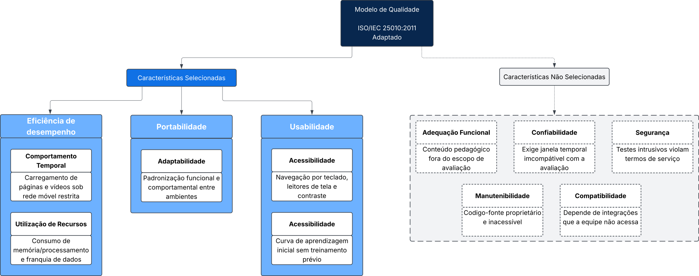

# Requisitos de avaliação

## 1. Propósito da avaliação e uso pretendido

### 1.1 Por que avaliar

A Khan Academy é uma plataforma educacional acessada pelo navegador e por aplicativos para Android e iOS. Parte dos alunos que poderiam usá-la estuda em condições desfavoráveis: celular de entrada, pouca memória, rede móvel lenta ou instável, sistemas operacionais variados e, em alguns casos, baixa visão ou outra necessidade de acessibilidade. Nessas condições, um conteúdo de boa qualidade pedagógica pode ficar inacessível na prática, porque a página demora a carregar, o vídeo trava, o layout quebra na tela pequena ou o leitor de tela não consegue ler o exercício.

O propósito da avaliação é **verificar se a Khan Academy atende, com qualidade suficiente, alunos que acessam a plataforma em ambientes com recursos limitados e com necessidades específicas**, produzindo evidências que apoiem a decisão de adotá-la como apoio ao ensino nesse contexto.

### 1.2 Cenário de aplicação

Para que o resultado apoie uma decisão concreta, a avaliação adota o seguinte cenário: *a coordenação de uma escola pública, cujos alunos usam majoritariamente celulares de entrada e rede móvel, decide se recomenda a Khan Academy como apoio às aulas e em qual forma de acesso (navegador ou aplicativo)*. O cenário é uma hipótese de trabalho da equipe, usada para orientar as escolhas.

### 1.3 Requisitante e destinatários dos resultados

O requisitante da avaliação é a coordenação da escola do cenário da seção 1.2, que precisa decidir se recomenda a Khan Academy aos alunos. A Tabela 1 mostra cada decisão que a avaliação apoia, quem a toma e qual resultado a sustenta.

| ID | Decisão apoiada | Quem decide | Resultado que apoia a decisão |
|---|---|---|---|
| `D1` | Recomendar ou não a plataforma para alunos com celular de entrada e rede limitada, e em qual forma de acesso (navegador ou aplicativo) | Coordenação da escola e professores | Comportamento temporal, utilização de recursos e adaptabilidade em cada ambiente avaliado |
| `D2` | Indicar a plataforma a alunos com baixa visão ou que usam leitor de tela, e com quais ajustes | Professores e responsáveis | Achados de acessibilidade nos fluxos principais |
| `D3` | Planejar uma aula introdutória sobre como usar a plataforma, ou dispensá-la | Professores | Facilidade de aprendizado dos fluxos principais por um aluno novo |
| `D4` | Definir objetivos, questões e métricas da Fase 2 e o rigor de cada parte da avaliação | Equipe avaliadora | Prioridades da [seção 2.3](#priorizacao) e rastreabilidade da [seção 4](#rastreabilidade) |

*Tabela 1. Decisões apoiadas pela avaliação. Fonte: Elaborada por: [Luisa de Souza](https://github.com/luisa12ll)*

A equipe de produto da Khan Academy é uma destinatária potencial dos achados, que podem indicar correções prioritárias. Como não há contato formal com a empresa, ela não é tratada como tomadora de decisão nesta avaliação.

### 1.4 Uso pretendido e limites

Os resultados serão publicados no artigo da disciplina e nesta GitPage, como relatório técnico de avaliação externa (caixa-preta). Não são certificação de qualidade, não comparam a Khan Academy com outras plataformas e não avaliam a qualidade do conteúdo pedagógico. Valem apenas para as versões, os dispositivos, as condições de rede e os perfis efetivamente avaliados, definidos pela equipe.

## 2. Características selecionadas

### 2.1 Modelo de referência e versão

A avaliação usa o modelo de qualidade de produto da **ISO/IEC 25010:2011**. Essa versão foi escolhida por três motivos: é a usada no material da disciplina, tem tradução da ABNT e é a base da ISO/IEC 25023:2016, norma de medição que fornecerá as métricas da Fase 2. Assim, modelo e medidas usam os mesmos nomes.

**Existe uma versão mais nova, a ISO/IEC 25010:2023**, que substitui a de 2011. Ela renomeou duas das características escolhidas e dividiu uma subcaracterística, como mostra a Tabela 2. A troca de versão não muda o que será avaliado, só os nomes. A Tabela 2 serve para quem consultar a versão de 2023 encontrar as características correspondentes.

| ISO/IEC 25010:2011 | ISO/IEC 25010:2023 | Mudança |
|---|---|---|
| Eficiência de desempenho: comportamento temporal, utilização de recursos | Eficiência de desempenho: comportamento temporal, utilização de recursos | Sem mudança nas subcaracterísticas selecionadas |
| Portabilidade: adaptabilidade | Flexibilidade: adaptabilidade | Característica renomeada |
| Usabilidade: apreensibilidade | Capacidade de interação: aprendizibilidade | Característica renomeada |
| Usabilidade: acessibilidade | Capacidade de interação: inclusividade e assistência ao usuário | Subcaracterística dividida em duas |

*Tabela 2. Correspondência entre os nomes da ISO/IEC 25010:2011 e da ISO/IEC 25010:2023 para as características selecionadas. Fonte: Elaborada por: [Luisa de Souza](https://github.com/luisa12ll), com base em ISO/IEC 25010:2011 e ISO/IEC 25010:2023*

Os termos em português da versão de 2011 seguem a tradução da ABNT; os da versão de 2023 são tradução da equipe.

### 2.2 Adaptação do modelo de qualidade e representação gráfica

O modelo geral da ISO/IEC 25010:2011 propõe uma estrutura abrangente voltada a qualquer produto de software. No entanto, uma avaliação externa (caixa-preta) focada na adoção da Khan Academy no contexto de escolas públicas requer uma adaptação deliberada. Um modelo genérico não reflete, por si só, os desafios de alunos que utilizam dispositivos móveis de baixo custo em conexões móveis instáveis, tampouco as limitações metodológicas de uma equipe avaliadora sem acesso ao código-fonte proprietário da plataforma.

Dessa forma, a decisão de adaptar o modelo sustenta-se nas seguintes razões práticas e autoevidentes:

1. **Poda e exclusão justificada:** Características que exigem acesso interno ao código-fonte proprietário (*Manutenibilidade*), testes de intrusão não autorizados em ambiente de terceiros (*Segurança*), observação temporal contínua e extensa (*Confiabilidade*) ou auditoria de matriz curricular (*Adequação Funcional*) foram descartadas por inviabilidade técnica ou desconexão com a avaliação externa do software (detalhadas na Seção 2.6).
2. **Foco nas subcaracterísticas críticas:** Das características mantidas, foram selecionadas estritamente aquelas que respondem às decisões concretas `D1` a `D3`. Em Usabilidade, por exemplo, o escopo prioriza *Acessibilidade* (inclusão de alunos com baixa visão ou usuários de tecnologias assistivas) e *Apreensibilidade* (capacidade de estudo autônomo sem exigir sobrecarga de orientação do professor), deixando de fora aspectos de estética visual ou operabilidade genérica.
3. **Refinamento operacional para a Khan Academy:** Cada subcaracterística ganha significado prático no contexto do produto, conectando-se diretamente aos atores e às decisões apoiadas, conforme estruturado na Figura 1.

*Figura 1. Modelo de qualidade adaptado da ISO/IEC 25010:2011 para a avaliação da Khan Academy. Fonte: Elaborada por: [José Augusto](https://github.com/JAugustoM)*

### 2.3 Características, subcaracterísticas e normas

A Tabela 3 lista as três características e as cinco subcaracterísticas selecionadas, com a norma que define cada uma e a norma que fornecerá as medidas.

| Característica | Subcaracterística | O que será observado na Khan Academy | Modelo | Medidas |
|---|---|---|---|---|
| Eficiência de desempenho | Comportamento temporal | Tempo para carregar páginas, iniciar vídeos e responder a exercícios | ISO/IEC 25010:2011 | ISO/IEC 25023:2016, medidas de comportamento temporal |
| Eficiência de desempenho | Utilização de recursos | Consumo de CPU, memória e dados de rede durante os fluxos principais | ISO/IEC 25010:2011 | ISO/IEC 25023:2016, medidas de utilização de recursos |
| Portabilidade | Adaptabilidade | Funcionamento dos fluxos principais em diferentes sistemas operacionais, navegadores e tamanhos de tela, sem alteração do produto | ISO/IEC 25010:2011 | ISO/IEC 25023:2016, medidas de adaptabilidade |
| Usabilidade | Apreensibilidade | Facilidade de um aluno novo aprender a encontrar um conteúdo, assistir a uma aula e resolver um exercício | ISO/IEC 25010:2011 | ISO/IEC 25023:2016, medidas de apreensibilidade |
| Usabilidade | Acessibilidade | Uso dos fluxos principais com leitor de tela, ampliação e alto contraste | ISO/IEC 25010:2011 | ISO/IEC 25023:2016, medidas de acessibilidade |

*Tabela 3. Características e subcaracterísticas selecionadas, com as normas de referência. Fonte: Elaborada por: [Luisa de Souza](https://github.com/luisa12ll), com base em ISO/IEC 25010:2011 e ISO/IEC 25023:2016*

### 2.4 Método de priorização

As subcaracterísticas foram priorizadas por uma matriz ponderada com três critérios, cada um pontuado de 1 (baixo) a 3 (alto):

- **Impacto no aluno (peso 3):** quanto um problema nessa subcaracterística impede o aluno do cenário da seção 1.2 de estudar. Tem o maior peso porque o propósito da avaliação é apoiar decisões sobre esses alunos.
- **Risco no contexto (peso 2):** quanto é provável que o problema apareça nas condições do cenário (aparelho de entrada, rede lenta, necessidade de acessibilidade).
- **Viabilidade de evidência (peso 1):** quanto a equipe consegue produzir evidência com os dispositivos, as ferramentas e o tempo disponíveis, sem acesso ao código-fonte. Tem o menor peso para que a facilidade de medir não decida sozinha a prioridade.

A pontuação é `P = 3 × Impacto + 2 × Risco + 1 × Viabilidade`, com máximo de 18. Prioridade **alta** quando `P ≥ 15`, **média** quando `12 ≤ P ≤ 14` e **baixa** quando `P ≤ 11`. Os pesos, as notas e as faixas são critério da equipe, não da norma.

| Subcaracterística | Impacto (×3) | Risco (×2) | Viabilidade (×1) | `P` | Prioridade |
|---|---|---|---|---|---|
| Comportamento temporal | 3 | 3 | 3 | 18 | Alta |
| Utilização de recursos | 3 | 3 | 2 | 17 | Alta |
| Adaptabilidade | 3 | 2 | 2 | 15 | Alta |
| Acessibilidade | 3 | 2 | 2 | 15 | Alta |
| Apreensibilidade | 2 | 2 | 2 | 12 | Média |

*Tabela 4. Matriz de priorização das subcaracterísticas. Fonte: Elaborada por: [Luisa de Souza](https://github.com/luisa12ll)*

Razões das notas que mais pesam no resultado:

- **Comportamento temporal e utilização de recursos** recebem risco 3 porque o cenário combina os dois fatores que mais degradam uma aplicação web rica em vídeo: aparelho com pouca memória e rede lenta. A viabilidade do comportamento temporal é 3, pois o navegador permite simular rede lenta e medir tempos sem equipamento extra; a da utilização de recursos é 2 porque medir o consumo no aplicativo móvel exige ferramentas que a equipe ainda precisa confirmar.
- **Adaptabilidade** tem impacto 3, pois o aluno usa o aparelho que tem, sem escolha; o risco é 2 porque plataformas desse porte costumam ter layout responsivo, mas as diferenças entre aplicativo, navegador e sistemas operacionais ainda precisam ser observadas.
- **Acessibilidade** tem impacto 3, pois uma barreira de acessibilidade impede completamente o uso por quem depende de leitor de tela, ainda que esse grupo seja menor. A viabilidade é 2 porque ferramentas automáticas encontram só parte dos problemas e o restante exige verificação manual.
- **Apreensibilidade** tem impacto 2, pois uma dificuldade inicial pode ser contornada com orientação do professor (decisão `D3`), ao contrário de uma barreira técnica ou de acessibilidade.

Agregando por característica, a ordem de prioridade é: (1) eficiência de desempenho, (2) portabilidade e (3) usabilidade, em que a acessibilidade tem prioridade alta e a apreensibilidade, média.

### 2.5 Trade-offs e consequências da priorização

A prioridade define o rigor de cada parte da avaliação, conforme previsto na ISO/IEC 25040:

- **Amplitude contra profundidade.** Três características e cinco subcaracterísticas cabem no prazo apenas se o rigor variar. As subcaracterísticas de prioridade alta recebem mais ambientes e repetições de medição; a apreensibilidade, de prioridade média, pode ser avaliada com menos participantes ou menos tarefas se o tempo ficar curto.
- **Eficiência no aplicativo móvel.** Se as ferramentas para medir consumo no aplicativo não estiverem disponíveis, a utilização de recursos fica restrita ao navegador. A decisão `D1` perde parte da comparação entre formas de acesso, e essa limitação será declarada.
- **Acessibilidade automática contra manual.** Verificar todos os fluxos com leitor de tela seria mais completo, mas custa tempo. A verificação manual fica nos fluxos principais definidos no escopo da avaliação, e o restante é coberto por ferramenta automática.

### 2.6 Características não selecionadas

A Tabela 5 registra por que as demais características da ISO/IEC 25010:2011 ficaram de fora.

| Característica | Motivo de não seleção |
|---|---|
| Adequação funcional | Avaliar se as funções estão completas e corretas se confunde com avaliar o conteúdo pedagógico, que está fora do propósito |
| Compatibilidade | A coexistência com outros aplicativos se sobrepõe à utilização de recursos, e a interoperabilidade depende de integrações que a equipe não acessa |
| Confiabilidade | Disponibilidade e tolerância a falhas exigem observação por um período mais longo que o da avaliação |
| Segurança | Testes de segurança em um sistema de terceiros exigem autorização do responsável pelo sistema |
| Manutenibilidade | Exige acesso ao código-fonte, que é proprietário |

*Tabela 5. Características da ISO/IEC 25010:2011 não selecionadas e motivo. Fonte: Elaborada por: [Luisa de Souza](https://github.com/luisa12ll)*

## 3. Justificativa da seleção

A tríade de características selecionadas alinha-se estritamente à viabilidade técnica de uma avaliação externa e ao cenário da escola pública:

- **Eficiência de desempenho:** Como a Khan Academy baseia-se em vídeo e interação dinâmica, a restrição de banda e memória é o primeiro obstáculo a superar. Medir tempos e tráfego subsidia a decisão `D1` quanto à viabilidade prática de estudo em redes móveis sem consumir excessivamente a franquia.
- **Portabilidade:** Ao focar em adaptabilidade, assegura-se que a plataforma mantenha integridade visual e funcional em múltiplos navegadores e formatos de tela (computadores escolares compartilhados vs. smartphones pessoais), respondendo à recomendação de forma de acesso de `D1`.
- **Usabilidade:** Ao priorizar acessibilidade e apreensibilidade, atende-se às decisões `D2` e `D3`, garantindo inclusão de alunos com deficiência visual e avaliando a necessidade de suporte pedagógico inicial para o uso autônomo da ferramenta.

## 4. Rastreabilidade: característica, interessado e justificativa

A Tabela 6 liga cada subcaracterística selecionada aos interessados que dependem dela, à justificativa e à decisão que apoia. Os identificadores `R1` a `R5` são os requisitos de avaliação que orientam a elaboração dos objetivos de medição no planejamento da avaliação. A coluna de objetivo GQM é uma proposta inicial; a redação final dos objetivos será consolidada nas etapas posteriores do estudo.

| ID | Característica: subcaracterística | Prioridade | Interessados | Justificativa | Decisão | Objetivo GQM proposto |
|---|---|---|---|---|---|---|
| `R1` | Eficiência de desempenho: comportamento temporal | Alta | Estudantes; coordenação e professores | Carregamento lento de páginas e vídeos em rede móvel impede o estudo antes de chegar ao conteúdo | `D1` | `G1` Eficiência de desempenho |
| `R2` | Eficiência de desempenho: utilização de recursos | Alta | Estudantes; responsáveis | Aparelhos de entrada têm pouca memória e o consumo de dados pesa no custo do pacote | `D1` | `G1` Eficiência de desempenho |
| `R3` | Portabilidade: adaptabilidade | Alta | Estudantes; coordenação e professores | O aluno usa o aparelho que tem; a recomendação precisa dizer em quais ambientes a plataforma funciona | `D1` | `G2` Portabilidade |
| `R4` | Usabilidade: acessibilidade | Alta | Estudantes com baixa visão ou que usam leitor de tela; professores; responsáveis | Uma barreira de acessibilidade bloqueia o uso por completo para esse grupo | `D2` | `G3` Usabilidade |
| `R5` | Usabilidade: apreensibilidade | Média | Estudantes novos; professores | Se o aluno não aprende a usar sozinho, o professor precisa planejar uma aula de introdução | `D3` | `G3` Usabilidade |

*Tabela 6. Rastreabilidade entre requisitos de avaliação, interessados, justificativas e decisões. Fonte: Elaborada por: [Luisa de Souza](https://github.com/luisa12ll)*

A equipe avaliadora é interessada em todos os requisitos, por meio da decisão `D4`, e por isso não aparece linha a linha.

## Referências

> INTERNATIONAL ORGANIZATION FOR STANDARDIZATION; INTERNATIONAL ELECTROTECHNICAL COMMISSION. **ISO/IEC 25010:2011**: Systems and software engineering - Systems and software Quality Requirements and Evaluation (SQuaRE) - System and software quality models. Genebra: ISO, 2011.

> INTERNATIONAL ORGANIZATION FOR STANDARDIZATION; INTERNATIONAL ELECTROTECHNICAL COMMISSION. **ISO/IEC 25010:2023**: Systems and software engineering - Systems and software Quality Requirements and Evaluation (SQuaRE) - Product quality model. Genebra: ISO, 2023.

> INTERNATIONAL ORGANIZATION FOR STANDARDIZATION; INTERNATIONAL ELECTROTECHNICAL COMMISSION. **ISO/IEC 25023:2016**: Systems and software engineering - Systems and software Quality Requirements and Evaluation (SQuaRE) - Measurement of system and software product quality. Genebra: ISO, 2016.

> INTERNATIONAL ORGANIZATION FOR STANDARDIZATION; INTERNATIONAL ELECTROTECHNICAL COMMISSION. **ISO/IEC 25040:2011**: Systems and software engineering - Systems and software Quality Requirements and Evaluation (SQuaRE) - Evaluation process. Genebra: ISO, 2011.

## Histórico de versões

| Versão | Data | Descrição | Responsável | Revisor | Commit |
|---|---|---|---|---|---|
| 1.0 | 17/10/2026 | Criação do documento: propósito, características com norma e prioridade, justificativa e rastreabilidade, com base na ISO/IEC 25010:2011 e nota sobre a versão de 2023 | [Luisa de Souza](https://github.com/luisa12ll) | |  |
