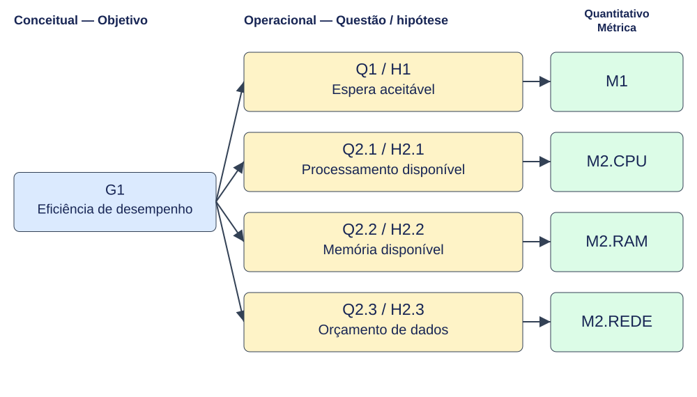
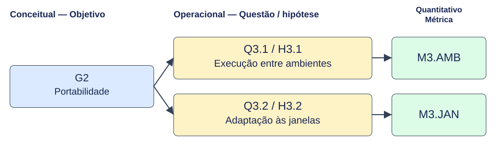
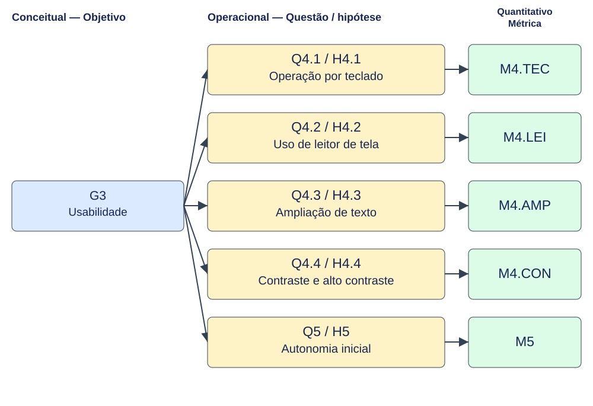

[← Visão geral da Fase 2](index.md)

# Diagrama GQM

A Figura 1 apresenta os níveis conceitual, operacional e quantitativo. Q2/H2, Q3/H3 e Q4/H4 são famílias; as 11 questões e hipóteses verificáveis constam da Tabela 1 e da página de [questões e hipóteses](questoes-hipoteses.md). Os sufixos são propostos, com alinhamento à issue #6 pendente.

*Figura 1 — Hierarquia GQM proposta para a Khan Academy. Fonte: elaboração com apoio de Codex a partir de R1–R5; revisão humana pendente.*

## Desdobramento por objetivo

As Figuras 2 a 4 apresentam individualmente as 11 questões e suas métricas, nos mesmos níveis da visão geral.

*Figura 2 — G1 — Eficiência de desempenho: ligações individuais G–Q/H–M. Fonte: especificação GQM desta fase, com apoio de Codex.*

*Figura 3 — G2 — Portabilidade: ligações individuais G–Q/H–M. Fonte: especificação GQM desta fase, com apoio de Codex.*

*Figura 4 — G3 — Usabilidade: ligações individuais G–Q/H–M. Fonte: especificação GQM desta fase, com apoio de Codex.*

## Matriz G–Q–H–M

A Tabela 1 detalha as ligações resumidas na figura, sem objetivos ou medidas órfãos.

**Tabela 1 — Correspondência por atributo.**

| Objetivo | Questão / hipótese | Métrica |
|---|---|---|
| R1 / G1 | Q1 / H1 | M1, por etapa e ambiente |
| R2 / G1 | Q2.1 / H2.1 | M2.CPU |
| R2 / G1 | Q2.2 / H2.2 | M2.RAM |
| R2 / G1 | Q2.3 / H2.3 | M2.REDE |
| R3 / G2 | Q3.1 / H3.1 | M3.AMB |
| R3 / G2 | Q3.2 / H3.2 | M3.JAN |
| R4 / G3 | Q4.1 / H4.1 | M4.TEC |
| R4 / G3 | Q4.2 / H4.2 | M4.LEI |
| R4 / G3 | Q4.3 / H4.3 | M4.AMP |
| R4 / G3 | Q4.4 / H4.4 | M4.CON |
| R5 / G3 | Q5 / H5 | M5, por tarefa e agregado |

*Fonte: requisitos R1–R5 e [fichas das métricas](metricas.md); proposta com revisão pendente.*

## Histórico de versões

| Versão | Data | Descrição | Responsável | Revisor | 
| :---: | :---: | :--- | :--- | :--- | 
| 1.0 | 18/10/2026 | Elaboração do diagrama GQM e da matriz de correspondência entre objetivos, questões e métricas. | [Geovanna Umbelino](https://github.com/GeovannaUmbelino) |[Pedro Lucas](https://github.com/Pwdrinho) | 
| 1.1 | 19/10/2026 | Sincronização da figura e da matriz com as 11 questões, hipóteses e medidas. | Camila Silva (apoio de Codex) | Revisão humana pendente |
| 1.2 | 19/10/2026 | Ajustes complementares da issue #7: observações e grupos, repetições, cobertura, hipóteses e figuras sincronizadas, com apoio de Codex. | Camila Silva | Revisão humana pendente |
| 1.3 | 19/10/2026 | Correção dos títulos quantitativos das Figuras 2–4, centralizados em duas linhas nos SVGs. | Camila Silva | Revisão humana pendente |

---

[Navegar pela Fase 2](index.md)
