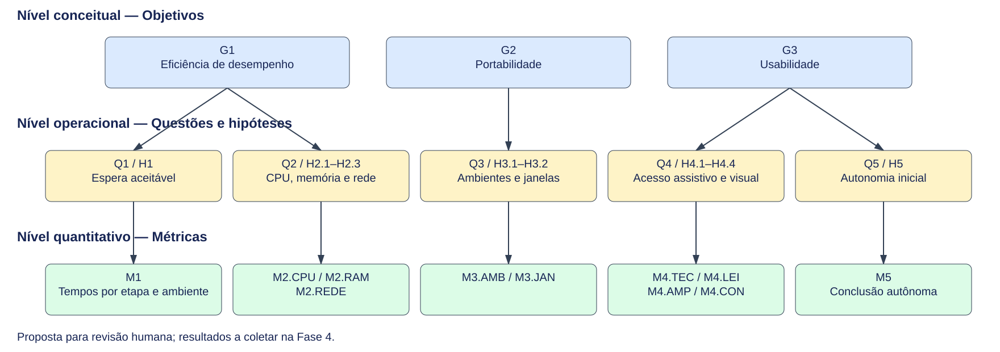

# Diagrama GQM

**Versão 1.3**

O diagrama GQM apresentado nesta página resume a estrutura lógica da especificação elaborada na Fase 2. Ele organiza a relação entre os **objetivos de medição (G)**, as **questões de avaliação (Q)** e as **métricas (M)**, mantendo os mesmos identificadores utilizados nas demais páginas da documentação.

Essa representação facilita a leitura integrada da Fase 2 e ajuda a verificar se cada métrica está, de fato, vinculada a uma questão e se cada questão deriva de um objetivo coerente com os requisitos priorizados na Fase 1. Assim, o gráfico complementa as páginas de [objetivos](objetivos.md), [questões e hipóteses](questoes-hipoteses.md), [métricas](metricas.md) e [rastreabilidade](objetivos.md).

A **Figura 1** apresenta os níveis conceitual (G), operacional (Q e H) e quantitativo (M), separados visualmente por objetivo. As setas ligam cada objetivo às questões, cada questão à sua hipótese e cada hipótese à medida que permite verificá-la.

*Figura 1 — Hierarquia GQM por objetivo, com questões, hipóteses e componentes de medição. Fonte: elaboração de [Geovanna Umbelino](https://github.com/GeovannaUmbelino) e [Camila Cavalcante](https://github.com/CamilaSilvaC)  com base nos requisitos R1–R5 da Fase 1.*

## 1. Matriz resumida G–Q–H–M

A **Tabela 1** explicita as mesmas ligações da Figura 1. As métricas são analisadas individualmente, conforme suas respectivas [fichas das métricas](metricas.md).

| Objetivo | Questão | Hipótese | Métrica / componente |
|---|---|---|---|
| [G1](objetivos.md) | [Q1](questoes-hipoteses.md) — Tempo mediano | H1 | M1 (tempo) e M2 (conclusão) |
| [G1](objetivos.md) | [Q2](questoes-hipoteses.md) — CPU | H2 | M3 |
| [G1](objetivos.md) | [Q3](questoes-hipoteses.md) — Picos de memória | H3 | M4 |
| [G1](objetivos.md) | [Q4](questoes-hipoteses.md) — Tráfego | H4 | M5 |
| [G2](objetivos.md) | [Q5](questoes-hipoteses.md) — SO e navegador | H5 | M6 |
| [G2](objetivos.md) | [Q6](questoes-hipoteses.md) — Tamanho de janela | H6 | M7 |
| [G3](objetivos.md) | [Q7](questoes-hipoteses.md) — Teclado | H7 | M8 |
| [G3](objetivos.md) | [Q8](questoes-hipoteses.md) — Leitor de tela | H8 | M9 |
| [G3](objetivos.md) | [Q9](questoes-hipoteses.md) — Ampliação | H9 | M10 |
| [G3](objetivos.md) | [Q10](questoes-hipoteses.md) — Contraste | H10 | M11 |
| [G3](objetivos.md) | [Q11](questoes-hipoteses.md) — Autonomia inicial | H11 | M12 (autonomia), M13 (erros) e M14 (tempo) |

*Tabela 1. Relação entre objetivos, questões, hipóteses e métricas. Fonte: elaboração de [Camila Cavalcante](https://github.com/CamilaSilvaC) e [Geovanna Umbelino](https://github.com/GeovannaUmbelino)*

## Referências

> BASILI, Victor R.; CALDIERA, Gianluigi; ROMBACH, H. Dieter. The Goal Question Metric Approach. In: **Encyclopedia of Software Engineering**. John Wiley & Sons, 1994. p. 528–532. 

## Histórico de versões

| Versão | Data | Descrição | Responsável | Revisor | 
| :---: | :---: | :--- | :--- | :--- | 
| 1.0 | 18/10/2026 | Elaboração do diagrama GQM e da matriz de correspondência entre objetivos, questões e métricas. | [Geovanna Umbelino](https://github.com/GeovannaUmbelino) | [Pedro Lucas](https://github.com/Pwdrinho) | 
| 1.1 | 19/10/2026 | Atualização técnica da figura e da matriz com G1–G3, Q1–Q11, H1–H11 e as famílias M1–M5. | [Camila Cavalcante](https://github.com/CamilaSilvaC) | [Pedro Lucas](https://github.com/Pwdrinho) |
| 1.2 | 20/10/2026 | Renumeração das métricas para M1–M14 e atualização da figura e da matriz. | [Geovanna Umbelino](https://github.com/GeovannaUmbelino) | [Pedro Lucas](https://github.com/Pwdrinho) |
| 1.3 | 21/10/2026 | Acrescenta referências bibliográficas usadas na elaboração do artefato | [Camila Cavalcante](https://github.com/CamilaSilvaC) | [Pedro Lucas](https://github.com/Pwdrinho) |