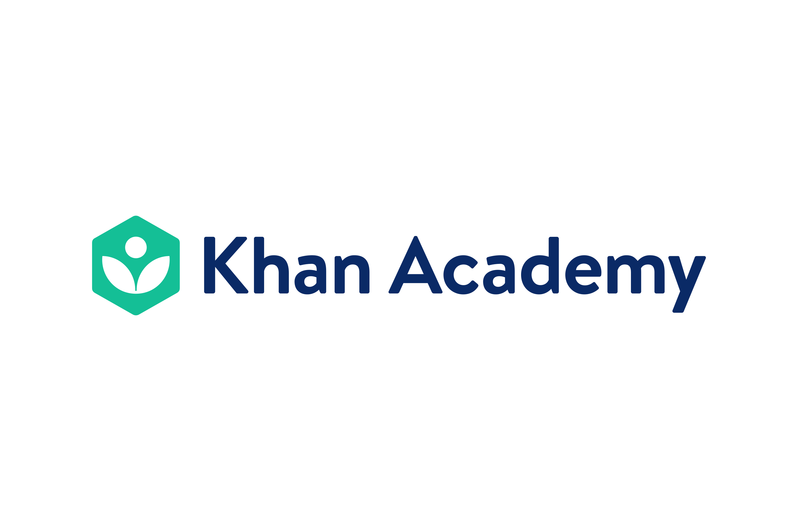

# Avaliação de Qualidade do Produto Khan Academy

Disciplina FGA0315 Qualidade de Software 1 | Profa. Cristiane Ramos | 2026-2

*Figura 1. Logo Khan Academy. Fonte: [Learning Engineering Virtual Institute](https://learning-engineering-virtual-institute.org/teams/khan-academy/.)*

## Sobre

<!-- Corrigir-->
Este site documenta a avaliação da qualidade do Khan Academy, plataforma de estudos online, seguindo o processo de avaliação de produto da família SQuaRE. A avaliação examina três características: portabilidade (adaptabilidade em diferentes sistemas operacionais), eficiência de desempenho (comportamento temporal e utilização de recursos) e usabilidade (apreensibilidade e acessibilidade), considerando diferentes perfis de alunos e suas necessidades específicas.

## Sumário

1. [Fase 1: Requisitos de avaliação](fase-1.md): propósito, produto, stakeholders e características selecionadas.
2. [Fase 2: Definição das métricas](fase-2.md): objetivos, questões, hipóteses e métricas (GQM), níveis de pontuação e critérios de julgamento.
3. [Gestão do projeto](gestao/plano_de_medicao.md): cronograma, medições PSM/CID, interpretações e decisões.
4. [Artigo](LINK): versões do artigo em PDF.
5. [Links do projeto](#links-do-projeto): repositório, releases e dados.

As Fases 3 e 4 (planejamento e execução da avaliação) serão publicadas na Entrega 2.

## Links do projeto

- [Repositório da equipe](https://github.com/ORGANIZACAO/REPOSITORIO)
- [Release da Entrega 1](https://github.com/ORGANIZACAO/REPOSITORIO/releases)
- [Dados da avaliação](https://github.com/ORGANIZACAO/REPOSITORIO/tree/main/dados)

## Equipe

| Foto | Nome | Matrícula |
|---|---|---|
|  | [Camila Silva](https://github.com/CamilaSilvaC) | 232013944 |
|  | [Enzo Menali](https://github.com/menali17) | 241011054 |
|  | [Geovanna Umbelino](https://github.com/GeovannaUmbelino) | 232014450 |
|  | [José Augusto](https://github.com/JAugustoM) | 231026429 |
|  | [Luisa de Souza](https://github.com/luisa12ll) | 232014807 |
|  | [Pedro Lucas](https://github.com/Pwdrinho) | 241025710 |

## Histórico de versões

| Versão | Data | Descrição | Responsável | Revisor | Commit |
|---|---|---|---|---|---|
| 0.1 | 14/10/2026 | Criação da página inicial | [Pedro Lucas](https://github.com/Pwdrinho) | | [d791d43](https://github.com/FCTE-Qualidade-de-Software-1/2026-2_T02_IRMA_MARY_KELLER/commit/d791d43d9bf73a2ce9fdaf0a73260e730d511e8b) |
| 0.2 | 18/10/2026 | Correções de imagens da equipe e link repositório |[Luisa de Souza](https://github.com/luisa12ll) | | [d6474db](https://github.com/FCTE-Qualidade-de-Software-1/2026-2_T02_IRMA_MARY_KELLER/commit/d6474db0ddde8b982d52a20802d9e69dfcefc38a) |